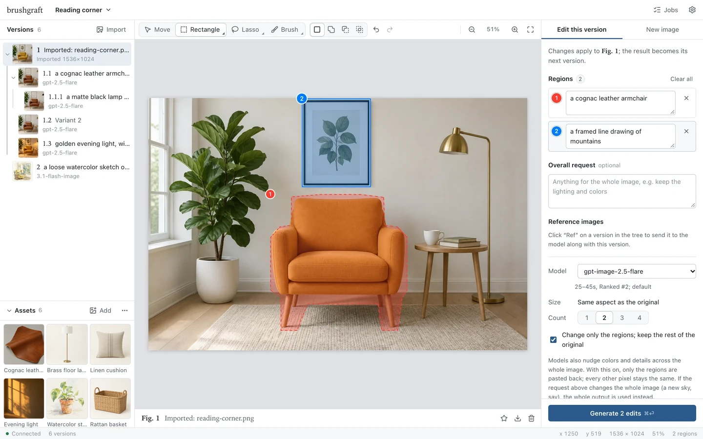
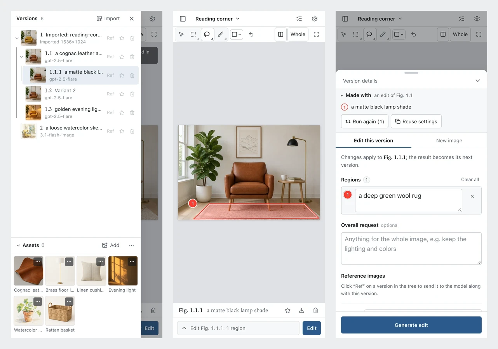
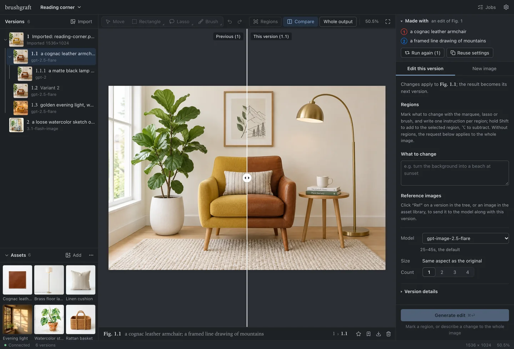

<div align="center">

# BrushGraft — An image editor that changes only what you mark and keeps every version

[](https://github.com/zeroherolin/brushgraft/actions/workflows/ci.yml)
[](LICENSE)
[](pyproject.toml)
[](web)
[](src/brushgraft/app.py)
[](#configuration)
[](https://github.com/zeroherolin/promptbrush)
[](tests)

**English** | [简体中文](README.zh-CN.md)

An image editor in your browser: mark what to change, say how in a sentence, and an image model does the rest. Every edit becomes a version in a tree that you can return to and branch from. Works with any OpenAI-compatible `/v1/images` API.

Run it on your own computer, or host it as a website where each visitor brings their own API key and keeps their projects in their own browser. Either way, projects and images are kept only on your own device, and only the image service you choose sees what you send it.

</div>



## Features

- **Regional edits**: mark regions with Photoshop-style selection tools (rectangular and elliptical marquee, freehand and polygonal lasso, brush and eraser) and give each its own instruction; one request can change several things. Shift adds to a region, Alt/⌥ subtracts, both intersect; regions can be moved and resized, and every step can be undone and redone.
- **Everything else stays pixel-identical**: only the regions are pasted back onto the original, and the paste-back grows to keep new content that spills past a region.
- **Version tree**: every edit is a numbered version (`1`, `1.2`, `1.2.1`) with 1–4 variants per request. Each version keeps the regions, instructions and reference images it was made with, shown above the edit panel and marked on the canvas, and a divider compares it with the previous version.
- **References and reuse**: use any version, or anything in the asset library, as a reference image; run an edit again for more variants, or load its regions into the parent to adjust them.
- **Asset library**: images every project shares, under the version tree: products, materials, style references. Click one to send it with the next edit, start a version or a project from it, or save the version on the canvas into it. What a version was made with stays with it, even after an asset is deleted, and the library moves between computers as one `.zip`.
- **Desktop and phone**: one-finger drawing and pinch zoom on phones; light and dark themes; English and Chinese UI.
- **Your data stays yours**: on the website, projects live in your browser and the key goes only to your image service; on your computer, in a workspace folder (SQLite plus content-addressed image files). Either way a project exports to one `.zip` and imports into the other.

<p align="center"></p>

## How it works

Measured across nine models (see promptbrush's `MODELS`), the API's `mask` parameter is respected only by `gpt-image-2-vip`, while sending the original together with an annotated copy that outlines and numbers each region lets every model find the right spot. So for each regional edit, brushgraft:

1. sends the original, the annotated copy and one instruction per region. Each region is outlined along its own shape, just outside it, not boxed: what is circled is exactly what you selected (a small region, or a bite the eraser took, included), and the model doesn't also repaint the corners a box would take in. Each is named by number and color (models mix up numbers alone, but read colors reliably). Both images are shown under Version details;
2. lines the model's output up with the original, pixel for pixel. Models draw at a size of their own and don't keep the framing exactly: scaled back, the output can sit a few pixels off (measured: up to 8 px on screenshots of unusual proportions), and every line and letter along the pasted edge would show twice. The scale and shift of each axis are measured on detail away from the regions (and what is left near them), and the output is resampled once onto the original's grid;
3. undoes the brightness and color drift the model applies to the whole image, measured away from the regions, so the pasted area doesn't show as a lighter or darker patch;
4. grows each region to take in the new content that belongs to it, whether it rises past the edge or sits just beside it, so nothing is cut off or left half see-through, then pastes it back with a feathered edge. Nothing that changed is blended half and half: a word the model rewrote past the region (it often rewrites the whole word or line) is taken whole, and a changed word or object within the feathered edge comes wholly from the output or wholly from the original, so text never shows the old letters through the new;
5. checks whether the model copied the outlines or numbers into its output: if it did, the original is put back along them, and the edit isn't let past them.

When a model redraws the scene instead of editing it (Gemini's 1024×1024 squares, or an occasional reframed output), or the image is longer than 3:1 (the most the models make), there is nothing to paste back, and the whole output is used. The same goes when your overall request changed the whole image as asked ("make the sky overcast"): the whole output is used, and the version with only the regions pasted back is kept under Version details.



## Website or your computer

| | Website | On your computer |
| --- | --- | --- |
| Install | Nothing | Python 3.10+ and Node.js (below) |
| Projects and images | In this browser | A workspace folder |
| API key | In this browser (or this tab only); sent to the image service you choose and nowhere else | `.env` in the workspace |
| Calls to the image service | Made by the page, so the service must allow web pages (CORS; OpenAI and most relay services do) | Made by the local server |
| Closing the page | Stops running jobs, so keep the tab open until they finish | Jobs keep running |
| Backup | Export a project as `.zip` (clearing site data deletes the rest) | Copy the folder, or export |

Both are the same interface and give the same results: the paste-back is written once in Python and once in TypeScript, and the tests check that, given the same inputs, the two produce identical pixels.

## Installation

Requires Python 3.10+, plus Node.js 20.19+ or 22.12+ to build the web UI.

```bash
git clone --recursive https://github.com/zeroherolin/brushgraft.git
cd brushgraft
make install    # create .venv, install dependencies and build the web UI
make run        # start and open the browser; options: make run ARGS="--port 8080"
```

To use your own environment instead, without `make`:

```bash
pip install -e external/promptbrush -e .
npm --prefix web ci && npm --prefix web run build
brushgraft
```

On start, brushgraft prints a link with an access token and opens it.

| Option | Description |
| --- | --- |
| `--dir DIR` | Workspace; default `$BRUSHGRAFT_HOME` or `~/brushgraft` |
| `--env-file PATH` | API settings file; default `.env` in the workspace |
| `--port PORT` | Default 7788; a free port is used if it's taken |
| `--host HOST` | Default `127.0.0.1` (this computer only). Use `0.0.0.0` to let other devices on your network connect, with the token, over plain HTTP, so only on networks you trust |
| `--no-browser` | Don't open a browser |

## Configuration

On first launch, Settings asks for the API key and base URL and saves them to `.env` in the workspace (mode 600). You can also set them yourself (see `config.example`):

| Variable | Description |
| --- | --- |
| `BRUSHGRAFT_API_KEY` | Required |
| `BRUSHGRAFT_BASE_URL` | Base URL up to `/v1`; default `https://api.openai.com/v1` |

Environment variables win over `.env`. promptbrush's `PROMPTBRUSH_*` variables work too, so an existing setup can be reused: `brushgraft --env-file path/to/promptbrush/.env`.

## Usage

1. Drop, paste or import an image, or switch to New image to start from a prompt.
2. Mark regions on the canvas, write an instruction for each, and press <kbd>⌘</kbd>/<kbd>Ctrl</kbd> + <kbd>Enter</kbd>. Each new shape makes a new region (a brush stroke that starts in the selected region adds to it, as Photoshop's Quick Selection brush does); to change the selected one instead, hold <kbd>Shift</kbd> (add), <kbd>Alt</kbd>/<kbd>⌥</kbd> (subtract) or both (intersect), or pick the mode beside the tools. Tools with a small triangle have a second variant: right-click or press and hold.
3. The regions clear once sent, so the next edit of the same version starts fresh (Restore draft in the notice brings them back). Results appear in the tree; select any version to keep editing from it.
4. Each result shows what it was made with: Run again for more variants, or Reuse settings to adjust. If the paste-back isn't right, switch to the model's whole output under Version details.
5. To delete a version and everything made from it, use the trash icon under the canvas or on its row in the tree.

The text brushgraft wraps around your instructions follows the UI language, so write instructions in that language.

| Shortcut | Action |
| --- | --- |
| <kbd>V</kbd> <kbd>M</kbd> <kbd>L</kbd> <kbd>B</kbd> <kbd>E</kbd> | Move (drag or resize regions), marquee, lasso, brush, eraser; <kbd>Shift</kbd>+<kbd>M</kbd> / <kbd>Shift</kbd>+<kbd>L</kbd> switch rectangle/ellipse and freehand/polygonal |
| <kbd>Shift</kbd> / <kbd>Alt</kbd> / both + draw | Add to, subtract from, intersect with the selected region |
| <kbd>Shift</kbd> / <kbd>Alt</kbd> / Space while dragging a marquee | Square or circle / from the centre / move it |
| Polygonal lasso | Click corners (<kbd>Shift</kbd>: at 45°); click the first, double-click or <kbd>Enter</kbd> to close; <kbd>Esc</kbd> cancels, <kbd>Backspace</kbd> removes a corner |
| <kbd>[</kbd> <kbd>]</kbd> <kbd>X</kbd> | Brush size (its diameter in image pixels, in Photoshop's steps); swap brush and eraser |
| <kbd>⌘</kbd>/<kbd>Ctrl</kbd> + <kbd>Z</kbd>, <kbd>⇧⌘Z</kbd>/<kbd>Ctrl</kbd>+<kbd>Shift</kbd>+<kbd>Z</kbd> | Undo, redo |
| <kbd>⌘</kbd>/<kbd>Ctrl</kbd> + <kbd>A</kbd> / <kbd>D</kbd> | Select the whole image / deselect |
| <kbd>Delete</kbd>, arrow keys | Delete the selected region; nudge it (<kbd>Shift</kbd>: 10 px). Dragging it with Move, <kbd>Shift</kbd> keeps the move straight or at 45° |
| <kbd>Esc</kbd> | Cancel the drag under way; deselect |
| <kbd>C</kbd> | Compare with the previous version |
| Wheel; <kbd>Shift</kbd> or <kbd>⌘</kbd>/<kbd>Ctrl</kbd> + wheel | Scroll up and down; left and right (trackpad: two fingers) |
| <kbd>Alt</kbd>/<kbd>⌥</kbd> + wheel, pinch | Zoom about the pointer (Settings › Zoom with scroll wheel swaps wheel and <kbd>Alt</kbd> + wheel, as in Photoshop) |
| Space + drag | Pan |
| <kbd>⌘</kbd>/<kbd>Ctrl</kbd> + <kbd>0</kbd> / <kbd>1</kbd> / <kbd>+</kbd> / <kbd>−</kbd> | Fit, 100%, zoom in, zoom out through Photoshop's zoom levels (also without <kbd>⌘</kbd>/<kbd>Ctrl</kbd>) |
| <kbd>Page Up</kbd> <kbd>Page Down</kbd> <kbd>Home</kbd> <kbd>End</kbd> | Scroll a screen up or down (<kbd>Shift</kbd>: 10 px); go to the top-left or bottom-right corner |
| Arrow keys (no region selected) | Move through the tree |

## Moving projects

Use the project menu: **Export current project** saves a `.zip` (versions, how each was made, and every image, including those of the assets used as references; never your key), and **Import a project** adds one as a new project, on the website or on your computer. Dropping a `.zip` onto the window imports it too.

The asset library moves the same way, from the **⋯** menu of its panel: **Export the asset library** saves it as a `.zip`, and **Import an asset pack** adds what isn't there yet; images already in the library are skipped. Dropping an asset pack onto the panel imports it too.

## Data and security

**On the website**, your projects and asset library live in this browser's IndexedDB and your key in its local storage (or session storage if you turn off "Remember the key on this device"). The site is static files: it has no server side to send them to, and its Content-Security-Policy only lets the page talk to itself, to `https:` services and to a service on this computer (`localhost`, `127.0.0.1`). Clearing the site's data deletes projects and the asset library, so export what you care about; Settings can also ask the browser to keep the data (storage persistence).

**On your computer**, everything lives in the workspace: `brushgraft.sqlite3` holds projects, version trees and the asset library, `images/` holds every image named by its SHA-256, and `thumbs/` is a disposable cache. Copy the directory to back it up. Only one brushgraft can use a workspace at a time.

Any web page can send requests to `127.0.0.1`, and every image costs money, so the API requires the access token (exchanged for an HttpOnly, SameSite=Strict cookie) and checks the Host header against DNS rebinding. Delete `.token` and restart to get a new token.

## Notes

- A failed request says what went wrong, its code (the HTTP status, or brushgraft's own) and what to do. The Jobs list keeps the service's raw answer under it, for a report to your provider.
- A request retried after a timeout or a gateway 524 may be billed for every attempt (at most five), since the service may have finished the earlier ones.
- Ctrl+C waits for requests already sent and saves their results; press it again to give up on them.
- Images over 4K (about 8.3 MP) are scaled down before sending, and reference images to about 2.4 MP; results are still pasted back at full size.
- The overall request and each region's instruction can have up to 30,000 characters, and everything sent together up to 40,000; a counter appears as you near the limit. Models allow less: measured, gpt-image-2 takes about 17,000 Chinese or 39,000 English characters, Gemini models more than 60,000. When a model turns a prompt down as too long, the error says so.
- On the website, results above about 36 MP are kept as the model's whole output instead of being pasted back, so a phone doesn't run out of memory.

## Development

```bash
make test     # backend tests, offline
make check    # lint, backend tests and web type check
make site     # build the website into web/dist
make dist     # build the sdist and wheel, web UI included
```

The backend (FastAPI) is in `src/brushgraft/`, the web UI (Svelte 5 + TypeScript + Vite) in `web/`, and UI text in `web/src/lib/locales/`. The UI talks to a `Backend` (`web/src/lib/backend/`): `ServerBackend` calls the local server, `BrowserBackend` keeps projects in IndexedDB, calls the image API itself and does the image work in a Worker. For live reload, run `brushgraft --no-browser` and `npm --prefix web run dev`, then open Vite's address with the printed `?token=…`.

Values both builds share (models, size rules, prompt texts, paste-back constants) are defined in Python and exported to `web/src/generated/spec.json` by `python scripts/export_spec.py`. `make check` also runs the web tests, which compare the TypeScript image code with Python's on the same inputs (`python scripts/parity_fixtures.py` makes them), and `npm --prefix web run test:e2e` drives the website and the local server in a real browser.

To publish your own copy of the website, clone this repository on your server and follow [docs/deploy.md](docs/deploy.md): `python3 deploy/deploy.py configure`, then `sudo python3 deploy/deploy.py`, and `sudo python3 deploy/deploy.py update` to update. Your own details (domain, filing number) stay in `local/site.json`, which git ignores.

promptbrush is pinned as a submodule in `external/promptbrush`; to update it, run `git -C external/promptbrush pull origin main` and commit the change.

## License

MIT — see [LICENSE](LICENSE).
