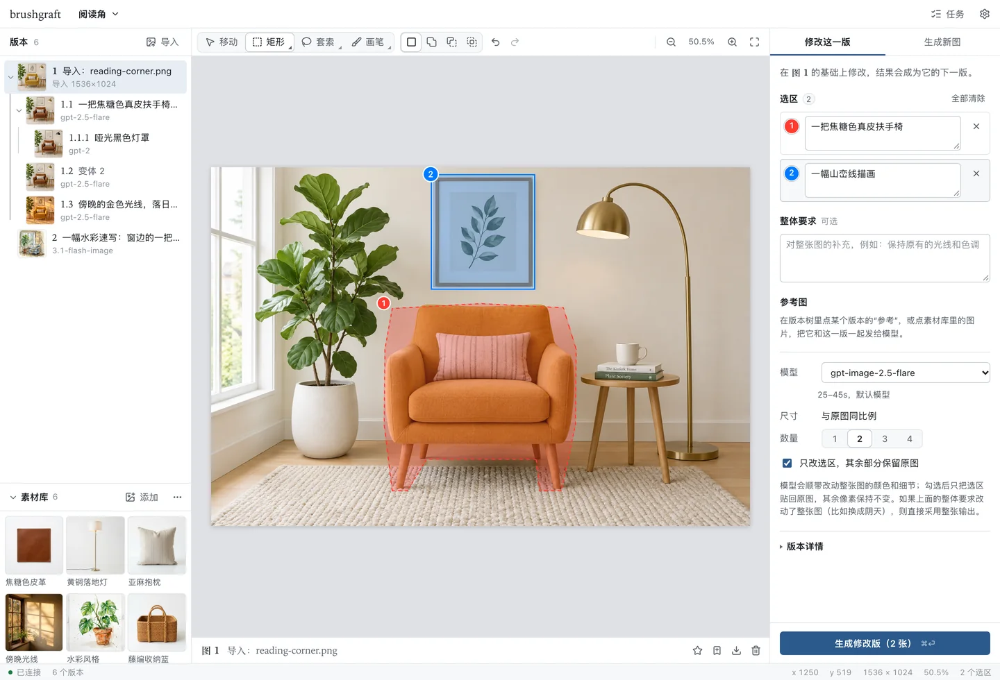
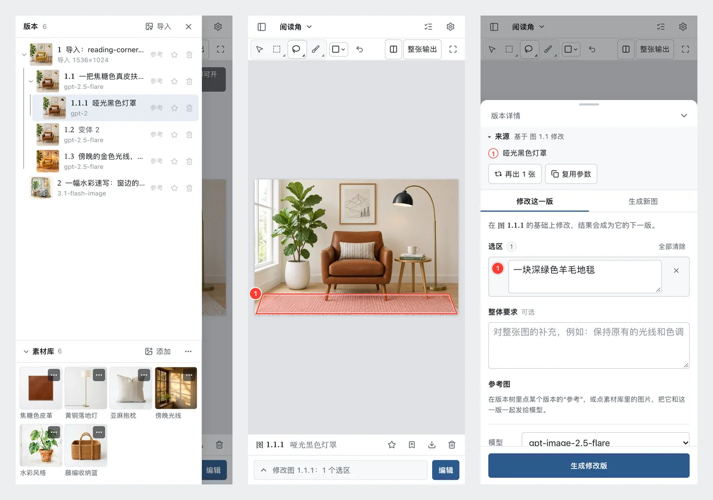
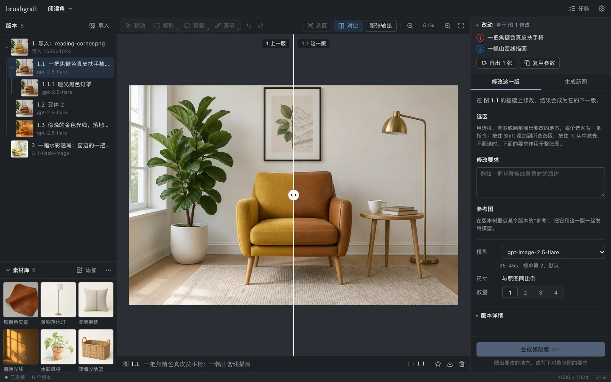

<div align="center">

# BrushGraft — 只改圈出部分、保留每一版的图片编辑器

[](https://github.com/zeroherolin/brushgraft/actions/workflows/ci.yml)
[](LICENSE)
[](pyproject.toml)
[](web)
[](src/brushgraft/app.py)
[](#配置)
[](https://github.com/zeroherolin/promptbrush)
[](tests)

[English](README.md) | **简体中文**

在浏览器里使用的图片编辑器：圈出要改的地方，用一句话说明怎么改，交给图像模型完成。每次修改都成为版本树上的一个新版本，可以随时回到任意一版重新分叉。支持任意 OpenAI 兼容的 `/v1/images` 接口。

可以装在自己电脑上运行，也可以部署成网站：每位访问者填自己的 API Key，项目只保存在各自的浏览器里。无论哪种方式，项目和图片都只保存在你自己的设备上，只有你选的图像服务会收到你发给它的内容。

</div>



## 特性

- **局部修改**：用和 Photoshop 一样的选区工具（矩形和椭圆选框、自由和多边形套索、画笔和橡皮擦）圈出选区，每个选区一条指令，一次请求可以改好几处。Shift 添加、Alt/⌥ 减去、两者同按取交叉；选区可以拖动和缩放，每一步都能撤销和重做。
- **其余部分逐像素不变**：只把选区贴回原图；模型画出的新内容超出选区时，贴回范围会随之扩大。
- **版本树**：每次修改都是一个编号版本（`1`、`1.2`、`1.2.1`），一次可出 1–4 张变体。每一版都保留生成它的选区、指令和参考图，显示在编辑面板上方，选区也在画布上标出；拖动分割线即可与上一版对比。
- **参考图与复用**：任意一版、素材库里的任意图片都能当参考图；可以把某次修改再跑几张，或把它的选区载入父版本调整后重跑。
- **素材库**：版本树下方是所有项目共用的图片：产品图、材质、风格参考等。点一下就会随下一次修改发给模型，也可以用它新建版本或项目，或把画布上的这一版存进素材库。每一版都记得生成它时用的图片，素材删除后也不受影响；整个素材库可以导出成一个 `.zip`，带到别的电脑或另一种版本里。
- **电脑与手机**：手机上单指圈选、双指缩放；浅色与深色主题；中文与英文界面。
- **数据归你自己**：网站版的项目存在你的浏览器里，Key 只发给你选的图像服务；电脑版存在工作目录里（SQLite 加按内容寻址的图片文件）。项目都能导出成一个 `.zip`，在两种版本之间互相导入。

<p align="center"></p>

## 工作原理

对 9 个模型的实测（数据见 promptbrush 的 `MODELS`）表明：接口的 `mask` 参数只有 `gpt-image-2-vip` 遵守，而把原图和一张圈出并编号了各选区的标注图一起发送，所有模型都能准确定位。所以每次局部修改时，brushgraft 会：

1. 发送原图、标注图和各选区的指令。标注图紧贴每个选区、沿它自身的形状描出轮廓，而不是套一个方框：圈出的就是你选中的范围（小选区、橡皮擦切掉的缺口都一样），模型也不会把方框多出来的角落一起改掉；每个选区同时用编号和颜色指明（只给编号时模型容易认错，颜色则很少认错）。两张图都可以在“版本详情”里查看；
2. 把模型的输出与原图逐像素对齐。模型按自己的尺寸作画，构图也不会分毫不差：缩放回原尺寸后，输出可能整体偏开几个像素（实测比例特殊的截图最多偏 8 像素），贴回边缘的每条线、每个字都会出现重影。brushgraft 在选区以外的细节上测出两个方向各自的缩放和平移（再用选区附近的细节修正剩余偏差），把输出一次重采样到原图的像素网格上；
3. 在选区以外测出模型给整张图带来的亮度和色偏，并予以抵消，贴回的部分不会像一块偏亮或偏暗的补丁；
4. 从选区出发，纳入属于这次修改的新内容（无论是长出选区边缘，还是紧挨着画在旁边），不会被截断，也不会半透明地叠在原图上，再羽化贴回原图。改动过的内容不会半新半旧地混在一起：模型把选区外的整个词也重写了（它常常会重写整个词或整行），就整个取用；羽化边缘里改动过的字或物体，要么整个用模型的、要么整个保留原图的，文字不会出现新字底下透出旧字的重影；
5. 检查模型有没有把轮廓线和编号照抄进输出：如果有，沿线条换回原图，修改也不会越过这些线条。

模型重画了整个画面而不是在原图上修改时（Gemini 系列的 1024×1024 方图，或偶尔重新取景的输出），或原图长宽比超过 3:1（模型最多只能输出 3:1）时，无法贴回，直接采用整张输出。整体要求本身就是改整张图（比如“背景改成阴天”）、模型也照做了时同样采用整张输出，只贴回选区的版本保留在“版本详情”里可切换。



## 网站版还是电脑版

| | 网站版 | 电脑版 |
| --- | --- | --- |
| 安装 | 无需安装 | Python 3.10+ 和 Node.js（见下） |
| 项目与图片 | 保存在这个浏览器里 | 保存在工作目录 |
| API Key | 保存在这个浏览器里（或只用于当前标签页），只会发给你选的图像服务 | 工作目录里的 `.env` |
| 调用图像服务 | 由网页自己发起，所以服务要允许网页访问（CORS；OpenAI 和大多数中转服务都允许） | 由本机服务发起 |
| 关闭页面 | 正在运行的任务会中断，请等它们完成再关 | 任务继续运行 |
| 备份 | 把项目导出为 `.zip`（清除网站数据会删掉其余内容） | 复制整个目录，或导出 |

两者是同一套界面、同样的结果：贴回算法在 Python 和 TypeScript 里各写了一份，测试会验证相同输入下两者输出的像素完全一致。

## 安装

需要 Python 3.10+，构建前端还需要 Node.js 20.19+ 或 22.12+。

```bash
git clone --recursive https://github.com/zeroherolin/brushgraft.git
cd brushgraft
make install    # 创建 .venv，安装依赖并构建前端
make run        # 启动并打开浏览器；传参：make run ARGS="--port 8080"
```

想用自己的环境、不用 `make` 时：

```bash
pip install -e external/promptbrush -e .
npm --prefix web ci && npm --prefix web run build
brushgraft
```

启动后终端会打印带访问令牌的链接，并自动打开。

| 参数 | 说明 |
| --- | --- |
| `--dir DIR` | 工作目录，默认 `$BRUSHGRAFT_HOME` 或 `~/brushgraft` |
| `--env-file PATH` | API 配置文件，默认是工作目录下的 `.env` |
| `--port PORT` | 默认 7788，被占用时自动换一个空闲端口 |
| `--host HOST` | 默认 `127.0.0.1`（仅本机）。填 `0.0.0.0` 后同一网络的其他设备也能访问（仍需令牌，但用的是明文 HTTP，只在可信网络里使用） |
| `--no-browser` | 不自动打开浏览器 |

## 配置

第一次打开时，“设置”会要求填入 API Key 和服务地址，保存在工作目录的 `.env` 里（权限 600）。也可以自行配置（见 `config.example`）：

| 变量 | 说明 |
| --- | --- |
| `BRUSHGRAFT_API_KEY` | 必填 |
| `BRUSHGRAFT_BASE_URL` | 服务地址，填到 `/v1` 为止；默认 `https://api.openai.com/v1` |

环境变量优先于 `.env`。也认 promptbrush 的 `PROMPTBRUSH_*` 变量，已有配置可以直接复用：`brushgraft --env-file path/to/promptbrush/.env`。

## 使用

1. 把图片拖进窗口、粘贴或导入；也可以切到“生成新图”从提示词开始。
2. 在画布上圈出选区，给每个选区写一条指令，按 <kbd>⌘</kbd>/<kbd>Ctrl</kbd> + <kbd>Enter</kbd> 提交。每画一个形状就是一个新选区（从所选选区里开始的画笔笔画会接着加进这个选区，同 Photoshop 的快速选择画笔）；要修改所选选区，按住 <kbd>Shift</kbd>（添加）、<kbd>Alt</kbd>/<kbd>⌥</kbd>（减去）或两者（交叉）再画，也可以在工具旁选择运算方式。右下角带小三角的工具还有另一种形态，右键或长按即可切换。
3. 提交后选区会清空，同一版的下一次修改从头开始（提示里的“恢复草稿”可以找回）。结果出现在版本树上，选中任意一版即可在它的基础上继续改。
4. 每个结果都会显示它的改动：点“再出 N 张”生成更多变体，点“复用参数”调整后重跑。对贴回效果不满意时，在“版本详情”里改为采用模型的整张输出。
5. 要删除某一版（连同由它生成的所有后续版本），点画布下方或版本树该行的垃圾桶图标。

brushgraft 包在指令外面的说明文字跟随界面语言，所以请用界面语言写指令。

| 快捷键 | 作用 |
| --- | --- |
| <kbd>V</kbd> <kbd>M</kbd> <kbd>L</kbd> <kbd>B</kbd> <kbd>E</kbd> | 移动（拖动、缩放选区）、选框、套索、画笔、橡皮擦；<kbd>Shift</kbd>+<kbd>M</kbd> / <kbd>Shift</kbd>+<kbd>L</kbd> 切换矩形/椭圆、自由/多边形 |
| 按住 <kbd>Shift</kbd> / <kbd>Alt</kbd> / 两者再圈选 | 添加到、从中减去、与所选选区交叉 |
| 拖动选框时按 <kbd>Shift</kbd> / <kbd>Alt</kbd> / 空格 | 正方形或正圆 / 从中心画 / 移动选框 |
| 多边形套索 | 单击放置拐点（<kbd>Shift</kbd>：限制为 45°）；单击第一个点、双击或按 <kbd>Enter</kbd> 闭合；<kbd>Esc</kbd> 取消，<kbd>Backspace</kbd> 删除上一个点 |
| <kbd>[</kbd> <kbd>]</kbd> <kbd>X</kbd> | 笔刷大小（直径以图片像素计，按 Photoshop 的档位）；切换画笔与橡皮擦 |
| <kbd>⌘</kbd>/<kbd>Ctrl</kbd> + <kbd>Z</kbd>，<kbd>⇧⌘Z</kbd>/<kbd>Ctrl</kbd>+<kbd>Shift</kbd>+<kbd>Z</kbd> | 撤销、重做 |
| <kbd>⌘</kbd>/<kbd>Ctrl</kbd> + <kbd>A</kbd> / <kbd>D</kbd> | 全选整张图 / 取消选择 |
| <kbd>Delete</kbd>、方向键 | 删除所选选区；微调它（<kbd>Shift</kbd>：10 像素）。用移动工具拖动时按住 <kbd>Shift</kbd>，只沿水平、垂直或 45° 移动 |
| <kbd>Esc</kbd> | 取消正在进行的拖动；取消选择 |
| <kbd>C</kbd> | 与上一版对比 |
| 滚轮；<kbd>Shift</kbd> 或 <kbd>⌘</kbd>/<kbd>Ctrl</kbd> + 滚轮 | 上下滚动；左右滚动（触控板：双指滑动） |
| <kbd>Alt</kbd>/<kbd>⌥</kbd> + 滚轮、双指捏合 | 以指针处为中心缩放（设置 › 用滚轮缩放：滚轮与 <kbd>Alt</kbd> + 滚轮互换，同 Photoshop） |
| 空格 + 拖动 | 平移 |
| <kbd>⌘</kbd>/<kbd>Ctrl</kbd> + <kbd>0</kbd> / <kbd>1</kbd> / <kbd>+</kbd> / <kbd>−</kbd> | 适应窗口、100%、按 Photoshop 的缩放档位放大、缩小（不按 <kbd>⌘</kbd>/<kbd>Ctrl</kbd> 也可以） |
| <kbd>Page Up</kbd> <kbd>Page Down</kbd> <kbd>Home</kbd> <kbd>End</kbd> | 上下滚动一屏（<kbd>Shift</kbd>：10 像素）；移到左上角、右下角 |
| 方向键（未选中选区时） | 在版本树中移动 |

## 在两个版本之间搬项目

用项目菜单：**导出当前项目**会保存一个 `.zip`（各版本、每一版的生成方式和全部图片，包括用作参考图的素材，不含你的 Key），**导入项目**会把它作为新项目加入，网站版和电脑版都可以。把 `.zip` 拖进窗口也能导入。

素材库也一样，用素材库面板的 **⋯** 菜单：**导出素材库**保存为一个 `.zip`，**导入素材包**会加入其中还没有的图片，已有的会跳过。把素材包拖到素材库面板上也能导入。

## 数据与安全

**网站版**的项目和素材库保存在这个浏览器的 IndexedDB 里，Key 在本地存储里（关闭“在这台设备上记住 Key”时放在会话存储里）。网站只有静态文件，没有任何服务端可以接收这些数据；它的 Content-Security-Policy 只允许页面访问自己、`https:` 服务和本机上的服务（`localhost`、`127.0.0.1`）。清除网站数据会删掉项目和素材库，重要的请导出备份；也可以在“设置”里请浏览器保留数据（存储持久化）。

**电脑版**的所有数据都在工作目录里：`brushgraft.sqlite3` 存项目、版本树和素材库，`images/` 存全部图片（以 SHA-256 命名），`thumbs/` 是可随时删除的缓存。备份时复制整个目录即可。同一个工作目录同时只能由一个 brushgraft 使用。

你浏览的任何网页都能向 `127.0.0.1` 发请求，而每次出图都要花钱，因此接口需要访问令牌（换成 HttpOnly、SameSite=Strict 的 cookie），并校验 Host 头以防 DNS rebinding。删掉 `.token` 后重启即可换新令牌。

## 注意事项

- 请求失败时，提示会写明原因、报错代码（HTTP 状态码，或 brushgraft 自己的代码）和处理建议；“任务”列表里还保留了服务返回的原始内容，可以直接发给服务商排查。
- 超时或网关 524 后重试的请求，每一次都可能计费（最多五次），因为服务端可能已经完成了之前的请求。
- 按 Ctrl+C 后会等已发出的请求完成并保存结果，再按一次放弃。
- 超过 4K（约 830 万像素）的图片发送前会缩小，参考图缩到约 236 万像素；结果仍按原尺寸贴回。
- 整体要求和每个选区的指令各最多 3 万字，发送的全部内容合计最多 4 万字；接近上限时输入框下会显示字数。模型自己的上限更低：实测 gpt-image-2 约可接受 1.7 万个汉字或 3.9 万个英文字符，Gemini 系列超过 6 万。模型因提示词过长拒绝时，错误信息会直接说明。
- 网站版遇到约 3600 万像素以上的结果时，直接保留模型的整张输出而不贴回，以免手机内存不足。

## 开发

```bash
make test     # 后端测试，全部离线
make check    # 代码检查、后端测试与前端类型检查
make site     # 构建网站版到 web/dist
make dist     # 构建 sdist 与 wheel（含前端）
```

后端（FastAPI）在 `src/brushgraft/`，前端（Svelte 5 + TypeScript + Vite）在 `web/`，界面文案在 `web/src/lib/locales/`。界面通过 `Backend`（`web/src/lib/backend/`）工作：`ServerBackend` 调用本机服务，`BrowserBackend` 把项目存进 IndexedDB、自己调用图像接口，并在 Worker 里处理图片。开发前端时运行 `brushgraft --no-browser` 和 `npm --prefix web run dev`，再把终端打印的 `?token=…` 拼到 Vite 的地址后面打开。

两种构建共用的值（模型列表、尺寸规则、提示词文本、贴回常量）在 Python 里定义，由 `python scripts/export_spec.py` 导出到 `web/src/generated/spec.json`。`make check` 还会运行前端测试，它们拿同样的输入对比 TypeScript 与 Python 的图像处理结果（由 `python scripts/parity_fixtures.py` 生成对照数据）；`npm --prefix web run test:e2e` 会在真实浏览器里同时测试网站版和本机服务。

想发布自己的网站版，在服务器上克隆本仓库，按 [docs/deploy.md](docs/deploy.md) 操作：先 `python3 deploy/deploy.py configure`，再 `sudo python3 deploy/deploy.py`；以后用 `sudo python3 deploy/deploy.py update` 更新。域名、备案号等个人信息只存在 `local/site.json`，git 会忽略它。

promptbrush 以 submodule 的形式固定在 `external/promptbrush`；升级时运行 `git -C external/promptbrush pull origin main` 并提交改动。

## 许可证

MIT — 见 [LICENSE](LICENSE)。
